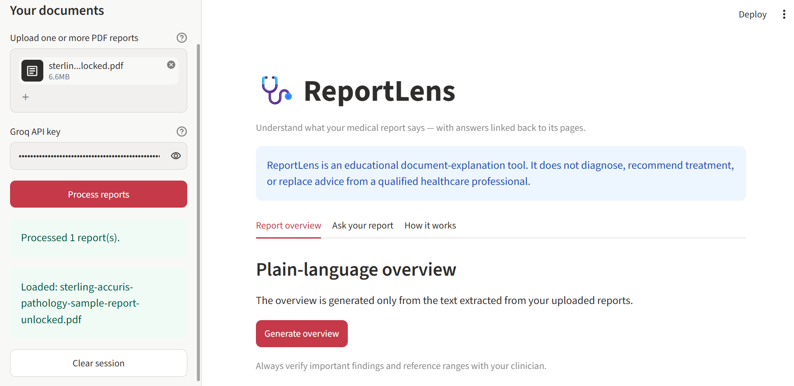
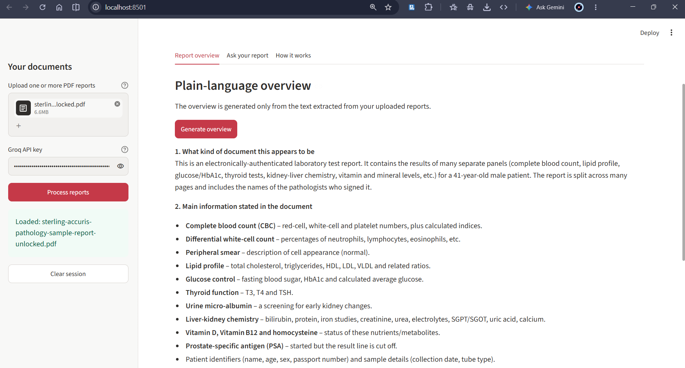
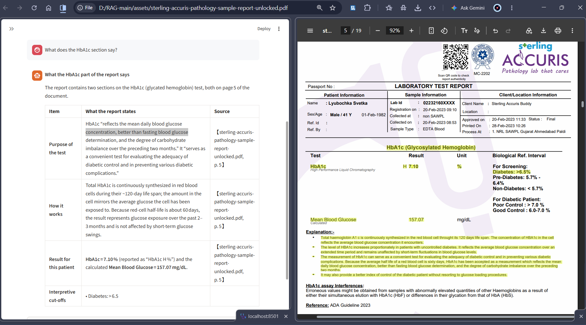

# ReportLens — Medical Report Explainer

ReportLens is a document-grounded assistant for exploring the wording and information in medical PDFs. It extracts text page-by-page, indexes passages locally, retrieves relevant evidence for a question, and returns an explanation with source-page references.

> **Important:** ReportLens is an educational document-explanation project. It does not diagnose medical conditions, recommend treatment, or replace a qualified healthcare professional. Do not use it for emergencies or clinical decisions.

## What it does

- Upload one or more text-based PDF reports in a Streamlit interface.
- Extract selectable text while retaining each page number and filename.
- Split text into overlapping passages for retrieval.
- Generate sentence embeddings with `all-MiniLM-L6-v2`.
- Search the passages with an in-memory FAISS index.
- Ask questions and receive answers grounded in retrieved excerpts.
- Display source filename and page citations with answers.
- Generate a short plain-language orientation to the uploaded report.

## Application Screenshots

### 1. Upload Medical Report
Upload a PDF medical report and process it for analysis.



### 2. Report Overview
Get a simplified overview of the uploaded medical report.



### 3. Ask Questions About Your Report
Ask questions and receive context-based answers with source page references.



## How it works

```text
PDF upload
   │
   ▼
Page-level text extraction (pypdf)
   │
   ▼
Overlapping passage creation + page metadata
   │
   ▼
SentenceTransformer embeddings
   │
   ▼
FAISS similarity search
   │
   ▼
Relevant passages + user question
   │
   ▼
Groq-hosted LLM → grounded explanation + page citations
```

The embedding and FAISS index run locally for the active session. Retrieved text is sent to Groq to generate the answer. Review the provider's privacy and data-handling terms before uploading sensitive documents. This prototype is not intended for production handling of protected health information.

## Run locally

### 1. Clone this repository

```bash
git clone https://github.com/bhumivedant49/RAG-Medical-Report-Analyst.git
cd RAG-Medical-Report-Analyst
```

### 2. Create and activate a virtual environment

```bash
python -m venv .venv
# Windows PowerShell
.venv\Scripts\Activate.ps1
# macOS / Linux
source .venv/bin/activate
```

### 3. Install dependencies

```bash
pip install -r requirements.txt
```

### 4. Configure the API key

Copy `.env.example` to `.env` and add your own Groq API key:

```env
GROQ_API_KEY=your_groq_api_key_here
```

Never commit `.env` or publish API keys.

### 5. Start the app

```bash
streamlit run main.py
```

You can also enter the Groq key in the app sidebar for the current session.

## Current limitations

- Scanned/image-only PDFs are not OCR-processed.
- The report index is held in memory and is cleared when the session is reset.
- The overview uses a bounded text excerpt for long reports; it may not cover every page.
- Retrieval quality depends on PDF text extraction and the relevance of the selected passages.
- Model-generated explanations can be incomplete or incorrect. Check important details against the original report and a clinician.

## Privacy notes

- Uploaded files are processed in the active Streamlit session; this prototype does not provide permanent report storage.
- The extracted text from retrieved passages and summary input is sent to Groq for generation.
- Do not upload identifiable or sensitive health documents unless you have reviewed and accepted the applicable provider terms and have permission to process them.

## Project structure

```text
.
├── app.py
├── main.py
├── src/
│   ├── __init__.py
│   ├── pdf_reader.py
│   ├── retriever.py
│   └── groq_client.py
├── assets/
│   ├── sterling-accuris-pathology-sample-report-unlocked.pdf
│   └── RAG_Working.webp
├── .env.example
├── .gitignore
└── requirements.txt
```

## Author

Bhumi Vedant
