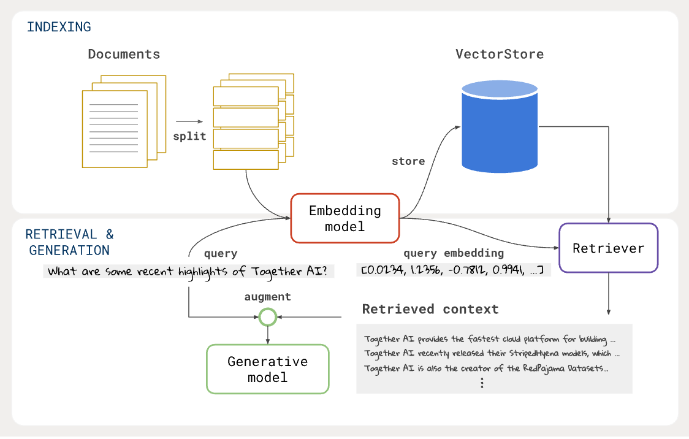
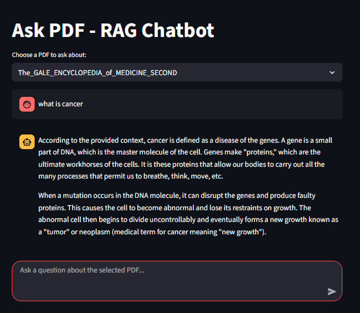

# 📚 Ask PDF - RAG Chatbot
A **Retrieval-Augmented Generation (RAG) chatbot** built with **Streamlit**, **LangChain**, **Groq API**, **FAISS**, and **HuggingFace embeddings**. This app allows you to **chat with your PDFs** and get context-aware answers.

## 🚀 Features
- 📄 Query any PDF stored in the `vectorstores/` folder  
- ⚡ Powered by **Groq’s Llama-3-8B** for fast responses  
- 🔍 Uses **FAISS** vector database for efficient retrieval  
- 🧠 Embeddings with HuggingFace `all-MiniLM-L12-v2`  
- 🎨 ChatGPT-like interface with **Streamlit**  
- ❌ Hallucination filter (rejects irrelevant answers)

##  App Workflow 




## 🛠️ Tech Stack
- [Python](https://www.python.org/)  
- [Streamlit](https://streamlit.io/)  
- [LangChain](https://www.langchain.com/)  
- [Groq API](https://groq.com/)  
- [FAISS](https://faiss.ai/)  
- [HuggingFace Transformers](https://huggingface.co/)  

## 📸 App Screenshot



## 📂 Project Structure

.
├── data/ # Raw PDF files (before embedding)

├── vectorstores/ # Precomputed FAISS vector databases

├── build_vectorstore.py # Script to create embeddings from PDFs

├── main.py / app.py # Streamlit chatbot app

├── phase_1.py,2.py,3.py # Experimentation files

├── .env # API keys (ignored in git)

├── .env.example # Example environment file

├── requirements.txt # Dependencies

└── README.md # Project documentation


## ⚙️ Setup & Installation
### 1️⃣ Clone Repo
```
git clone https://github.com/Harshal-2004/RAG.git
cd (https://github.com/Harshal-2004/RAG)
```
2️⃣ Install Requirements
```
pip install -r requirements.txt
```
3️⃣ Setup Environment Variables
```
Create a .env file (not tracked in git):
GROQ_API_KEY=your_groq_api_key_here
```
4️⃣ Build Vectorstores (from PDFs)
```
python build_vectorstore.py
```
5️⃣ Run the Streamlit App
```
streamlit run main.py
```

🎯 Usage

Select a PDF (vectorstore) from the dropdown.

Ask a question in the chat input.

Get context-based answers directly from the PDF.


🤝 Contributing

Contributions are welcome!

Fork the repo

Create a new branch (feature/your-feature)

Commit changes and open a Pull Request


📜 License

This project is licensed under the MIT License – see the LICENSE file for details.

🙌 Acknowledgements

LangChain

Groq

HuggingFace

FAISS

Streamlit


📧 Contact
👤 Author: Bhumi Vedant, Harshal Shirole, Ayush Nair

